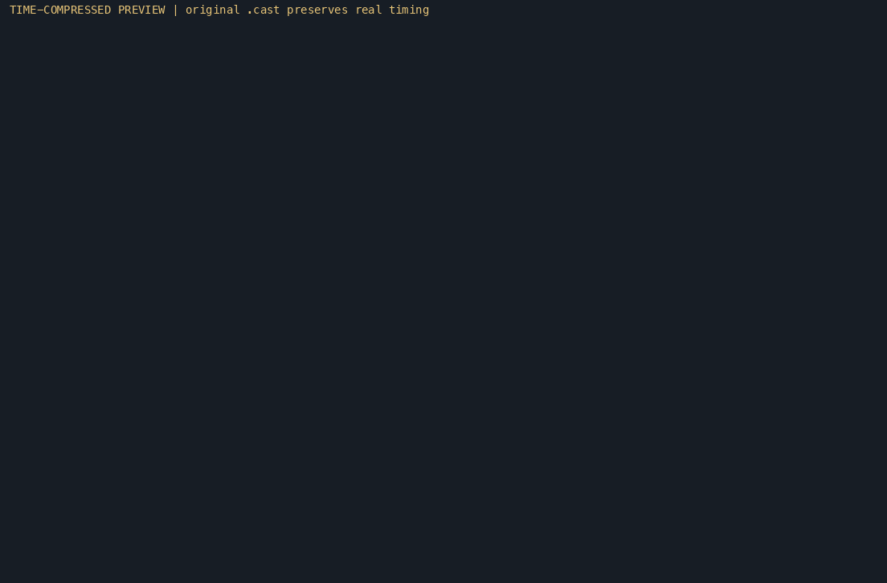
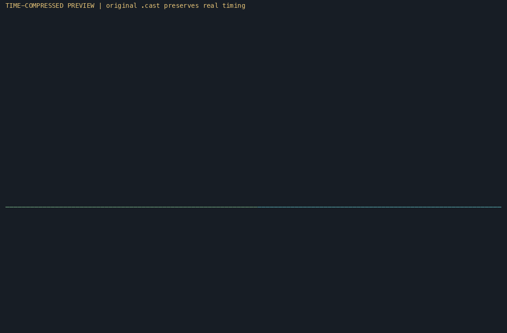

# oci-mirror-proxy

[English](README.md) | [简体中文](README.zh-CN.md)

A local, read-only registry mirror proxy for dockerd. It sits between dockerd and
one or more user-chosen Registry v2 mirrors and adds what dockerd's built-in
mirror support lacks:

- **Runtime management.** Add, remove and disable upstreams without restarting dockerd.
- **Failure isolation.** A silent or failing mirror costs one timeout, then a
  circuit breaker takes it out of rotation until a probe succeeds.
- **Optional racing.** Hedged requests can answer from whichever mirror responds first.
- **Resumable layers.** A layer that breaks mid-transfer continues from the same
  byte offset on another mirror, and the daemon still verifies the digest.
- **Safe fallback.** When the proxy cannot serve a request, dockerd falls back to
  the official registry, so the proxy can never make a pull impossible.

It supports both dockerd image stores: containerd (`hosts.toml`) and the classic
graphdriver store (`daemon.json`, docker.io only).

## Preview

oci-mirror-proxy completed in **508.0 s** versus **740.3 s** directly from the
mirror: **1.46× as fast**, or **31.4% less time** in this preview.

| Direct mirror · 740.3 s | Through oci-mirror-proxy · 508.0 s |
| :---: | :---: |
|  |  |
| [asciinema recording](docs/demos/direct-mirror.cast) | [asciinema recording](docs/demos/oci-mirror-proxy.cast) |

GIFs are time-compressed previews; the original recordings preserve real timing.

## Status

Supported features: the registry API for pulls, failover, circuit breaking,
hedged requests, blob resumption, token and basic authentication, the admin socket,
configuration reload, and dockerd setup with revert.

Not supported: push, a local blob cache, keychain secret backends, and metrics export.

## Requirements

- Go 1.26 or newer, to build.
- A local Docker Engine on Linux or Docker Desktop on macOS/Windows (Linux containers). See
  [automatic Docker integration](docs/docker-integration.md). Rootless dockerd needs the listen address
  reachable from its network namespace, which is left to the operator (see
  [docs/operations.md](docs/operations.md#rootless-dockerd)).

## Installation

Install the latest release from [GitHub](https://github.com/runui/oci-mirror-proxy)
without cloning the repository:

```sh
curl -fsSL https://github.com/runui/oci-mirror-proxy/raw/refs/heads/master/install.sh | DOWNLOAD_BASE_URL=https://github.com/runui/oci-mirror-proxy sh -s -- --prefix "$HOME/.local"
export PATH="$HOME/.local/bin:$PATH"
oci-mirror-proxy version
```

Update an existing installation:

```sh
curl -fsSL https://github.com/runui/oci-mirror-proxy/raw/refs/heads/master/install.sh | DOWNLOAD_BASE_URL=https://github.com/runui/oci-mirror-proxy sh -s -- --update --prefix "$HOME/.local"
```

On Linux, install and start a system service with root privileges:

```sh
curl -fsSL https://github.com/runui/oci-mirror-proxy/raw/refs/heads/master/install.sh | sudo env DOWNLOAD_BASE_URL=https://github.com/runui/oci-mirror-proxy sh -s -- --service
# Update the system installation and restart its service:
curl -fsSL https://github.com/runui/oci-mirror-proxy/raw/refs/heads/master/install.sh | sudo env DOWNLOAD_BASE_URL=https://github.com/runui/oci-mirror-proxy sh -s -- --update --prefix /usr/local --service
```

The script downloads the matching Linux, macOS, or FreeBSD binary and verifies
its SHA256 checksum. When no matching binary is available, or `--build` is
specified, it builds release source using Go 1.26.8 or newer (or Go toolchain
auto-download). Use `--version v1.0.1` to select a release.
To use a mirror, set `DOWNLOAD_BASE_URL` to its repository root URL (with the
same `/releases` and `/archive` layout). When piping the script, pass the variable
to `sh`, not just to `curl`:

```sh
curl -fsSL https://github.com/runui/oci-mirror-proxy/raw/refs/heads/master/install.sh | DOWNLOAD_BASE_URL=https://mirror.example.com/runui/oci-mirror-proxy sh -s -- --prefix "$HOME/.local"
```

The default prefix is `/usr/local`, which requires write permission. Existing
configuration is preserved; without `--service`, no service is installed or restarted.
Restart a running proxy manually after updating without `--service`.

### Platforms and Windows installation

Prebuilt binaries are available for the following platforms:

| System | Architectures | Archive |
| --- | --- | --- |
| Linux | amd64, arm64, armv7, riscv64 | `.tar.gz` |
| macOS | amd64, arm64 | `.tar.gz` |
| FreeBSD | amd64, arm64 | `.tar.gz` |
| Windows | amd64, arm64 | `.zip` |

On Windows, download and inspect the PowerShell installer, then run it in
PowerShell. Approve the Windows administrator prompt when requested:

```powershell
Invoke-WebRequest https://github.com/runui/oci-mirror-proxy/raw/refs/heads/master/install.ps1 -OutFile install.ps1
.\install.ps1 -DownloadBaseUrl https://github.com/runui/oci-mirror-proxy
# Update the installation and restart its service:
.\install.ps1 -DownloadBaseUrl https://github.com/runui/oci-mirror-proxy -Update
```

The installer starts the proxy as a Windows service, enables startup at boot,
and adds the program to PATH. Open a new terminal to run `oci-mirror-proxy`
directly. Updates preserve existing configuration. .NET Framework 4.x is required.

For service management and Docker Desktop setup, see [operations](docs/operations.md).
For optional installation settings, run `Get-Help .\install.ps1 -Full`.

The `--service` option supports Linux systemd/OpenRC and macOS launchd system
services. Sudo installs without `--service` initialize user configuration as the
verified invoking user. See [macOS installation and permissions](docs/macos-installation.md)
for service management and recovery from older root-owned user configurations.

## Docker deployment

Docker Engine and macOS Docker Desktop users can deploy with [docker-compose.yaml](docker-compose.yaml). Prepare
the writable configuration directory, then run `docker compose up -d --no-build`.
The image supports amd64/arm64 and uses bridge networking with a host-loopback-only
published port, without mounting the Docker socket. See [Docker deployment](docs/docker.md)
for setup, local builds, and host dockerd configuration.

## Quick start

```sh
make build                                   # produces dist/oci-mirror-proxy

dist/oci-mirror-proxy init                   # writes the per-user config file
dist/oci-mirror-proxy serve &                # runs the proxy in the background

dist/oci-mirror-proxy upstream add \
  --id mirror-a --url https://mirror-a.example.com

sudo dist/oci-mirror-proxy dockerd plan      # shows what will change; writes nothing
sudo dist/oci-mirror-proxy dockerd apply     # writes the dockerd configuration
dist/oci-mirror-proxy doctor                 # verifies proxy, dockerd and config
```

Start from [examples/config.example.yaml](examples/config.example.yaml) for a
complete configuration with every option explained.

## Documentation

### Regional mirror catalogs

```sh
oci-mirror-proxy remote update --url https://github.com/runui/oci-mirror-proxy/raw/refs/heads/master/subscriptions/mirrors.json --region cn
oci-mirror-proxy remote list
oci-mirror-proxy remote show --url https://example.com/mirrors.json --region cn
oci-mirror-proxy remote update --all
```

The CLI supports custom `--url` JSON catalogs, per-source `.d` configuration,
URL deduplication, atomic updates and previous-result backups. See
[remote catalogs](docs/remotes.md) and [catalog details](subscriptions/README.md).
Reloads preserve in-flight HTTP transfers and their resume candidates.

- [docs/docker.md](docs/docker.md): Docker/Compose deployment and local builds.
- [docs/configuration.md](docs/configuration.md): every configuration key and its default.
- [docs/operations.md](docs/operations.md): commands, dockerd integration, reload, troubleshooting.
- [docs/architecture.md](docs/architecture.md): components, request flow and failure handling.
- [docs/testing.md](docs/testing.md): running checks and a local smoke test.

## Security notes

- The registry API has no authentication, so it listens on `127.0.0.1` by default.
  A non-loopback `listen` exposes unauthenticated pulls to the network.
- Credentials never appear in the configuration file: a password is a reference
  such as `env:NAME` or `file:/path`. Secrets are redacted in logs and in `%v` output.
- Client `Authorization` headers are never forwarded upstream.
- The admin socket is protected by file permissions: its directory is `0700`, and
  the socket is `0600`.
- Files that dockerd apply writes are backed up first, and revert restores them.
  Files that this tool did not create are not overwritten without `--force`.
